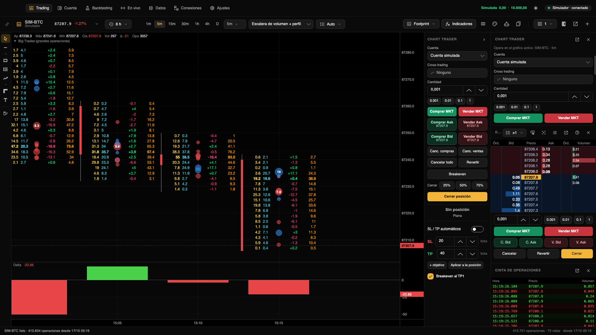
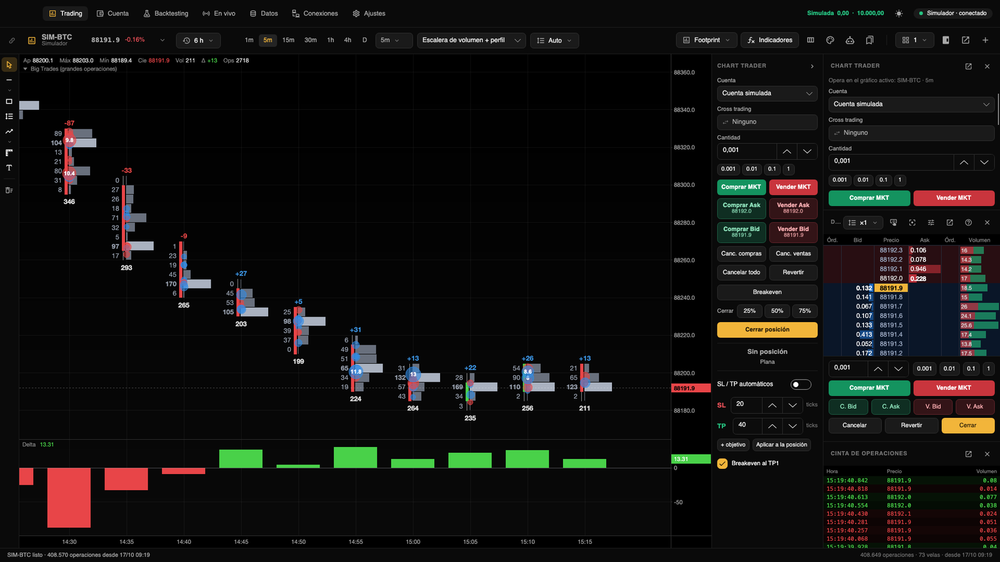
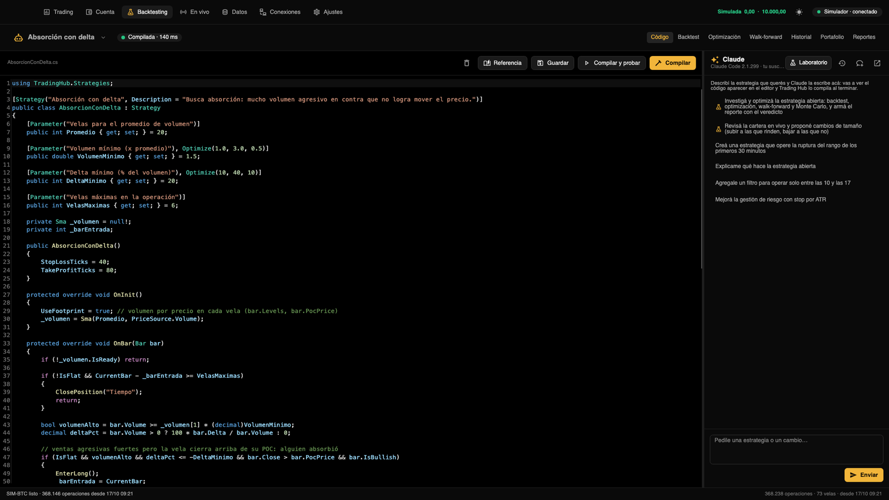
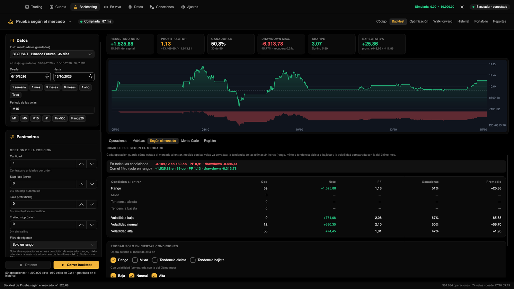
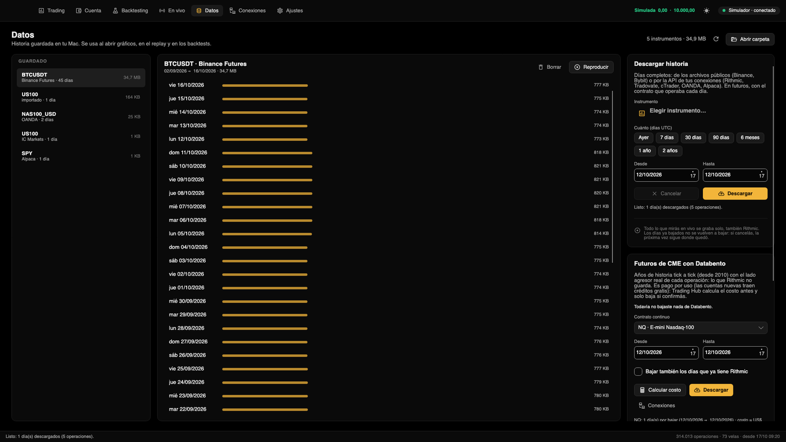

<div align="center">

# Trading Hub

**The free, open-source trading platform that runs 100% on your Mac.**
Footprint charts, DOM trading, professional overfitting-resistant backtesting, and AI strategies,
with your data and keys always on your computer.

Created by [**@ralphtradesz**](https://x.com/ralphtradesz)

Do you use Windows? [See how to port it with Claude](#do-you-use-windows).

[](LICENSE)


</div>

---

## What is it

Trading Hub is a free, open-source desktop trading platform. Everything runs locally: the app, the
data you save or download, your strategies, the backtests, and your broker keys (stored in the macOS Keychain, never
in files). It has no servers of its own, no accounts to create, and no telemetry.

It works with **CME futures** (Rithmic, Tradovate, and Databento history), **crypto** (Binance and Bybit, with free
data and no keys), **forex and CFDs** (OANDA, cTrader, or CSV files), and **US stocks** (Alpaca).

AI runs through **Claude Code with your own subscription** (no API keys): a wizard that writes strategies in C#,
compiles them, tests them, and creates reports, plus an agent that allocates risk across your live strategies.

## Features

### Charts
- Time, ticks, volume or range candles; candles, bars, line or Heikin Ashi.
- **Footprint** configurable column by column (bid/ask, delta, volume, POC, profile per candle) with its own editor.
- DOM, trade tape, drawings, and templates.
- Indicators included: moving averages, VWAP with deviations, Bollinger, RSI, MACD, volume, delta, cumulative delta (CVD),
  volume profile per session and large trades. Add yours in C# (recompiled when saving), compatible with
  the ATAS Indicators API, and those from ATAS or other public code sources: see
  [More indicators](#more-indicators).
- **Replay** of any saved day, at the speed you want.

### Trading
- **Chart Trader** and DOM with market, limit, and stop orders, brackets (stops and targets), and OCO.
- Simulated accounts included and real accounts from your connections; history and statistics per account.
- Simulated accounts never block your clicks; for real accounts you can request confirmation before each order (disabled
  in Settings). Safety comes from risk limits.

### Data
- Everything you watch is recorded tick by tick, with the aggressor side.
- Downloads: Binance and Bybit public files, history of Rithmic and your connections.
- **Databento**: years of CME futures tick data (pay as you go, with the cost shown upfront). It is stored separately, and in
  backtests you choose **Rithmic only, Databento only, or both combined** (Rithmic first, with Databento filling the gaps).
- CSV import from Dukascopy, HistData, MetaTrader or TradingView.

### Strategies and backtesting
- Strategies in **C#** with a built-in editor that compiles in milliseconds (Roslyn, with errors marked in the
  code) and a simple API: `EnterLong()`,
  `StopLossTicks`, indicators, time and market context filters.
- Backtests on every real trade saved, with commissions, slippage and realistic limit order filling.
- **Bayesian optimization** (TPE) and **smart walk-forward**: choose stable plateaus instead of peaks, compress ticks
  to run faster, and measure overfitting with **PBO (CSCV)** and **CPCV with embargo**. The library also includes the
  **deflated Sharpe** and full validation for use from code.
- The **timeframe** is optimized as another parameter (M1 to D1), and your **favorite** strategies stay at the top of the list.
- **Monte Carlo**, **results by market** (range, mixed, or trend; low, normal, or high volatility), and robustness metrics
  so you do not confuse luck with edge.

### Live
- Run strategies in your accounts from the backtester or from a chart, with maximum size, daily loss and drawdown.
  In the chart you see how it went in its history: real results with costs, a mini curve and all the statistics.
- Portfolios, a **risk agent powered by Claude** that proposes position sizes (approved by you for real accounts),
  real-time market conditions, and a dashboard in the Mac menu bar.
- Automatic resume on launch and sleepless mode (including with the lid closed, if you want).

### Claude
- A chat that writes and fixes strategies, and a **laboratory** (an MCP server built into the app) where Claude runs
  backtests, optimizations, and walk-forwards, then leaves you a professional report with every metric.

## Screenshots

| | |
|---|---|
|  |  |
| Footprint with delta, POC, and large trades | Chart Trader, DOM, and trade tape |
|  |  |
| Strategies in C# with Claude's assistant | Backtesting with results by market |
|  |  |
| Tick-by-tick history and Databento | Light or dark theme |

## Installation

### The easiest: with Claude Code
If you have [Claude Code](https://claude.com/claude-code), open a Terminal in this folder, run `claude` and ask it:

```
Install Trading Hub on my Mac by following CLAUDE.md.
```

It checks your Mac, installs what is missing (without an administrator password), compiles the app, and leaves it in Applications.
The step-by-step guide is in [INSTALL_WITH_CLAUDE_CODE.md](INSTALL_WITH_CLAUDE_CODE.md).

### By hand
You need a Mac with Apple Silicon and macOS 12 or newer (for Windows, see [Do you use Windows?](#do-you-use-windows)).

```bash
curl -sSL https://dot.net/v1/dotnet-install.sh -o /tmp/dotnet-install.sh
bash /tmp/dotnet-install.sh --channel 10.0
git clone https://github.com/ralphtradesz/trading-hub.git
cd trading-hub
./build-app.sh --install
```

The first build takes a few minutes. The app is installed at `/Applications/Trading Hub.app` and starts with a simulated
account: nothing trades real money until you enable it in Connections. More details in
[docs/installation.md](docs/installation.md).

## Do you use Windows?

Trading Hub is currently built for Apple Silicon Macs, but it is made with .NET and Avalonia, which also run on
Windows: the macOS-specific parts are few and well identified. With **Claude Code** you can port it on your PC,
in stages, with passing tests at every step.

1. Install on the PC (Windows 10 or 11 64-bit): [Git](https://git-scm.com), the
   [.NET 10 SDK](https://dotnet.microsoft.com/download), and [Claude Code](https://claude.com/claude-code), then sign in
   with your Claude account.
2. Clone the repository and open a terminal in the folder:
   ```bash
   git clone https://github.com/ralphtradesz/trading-hub.git
   cd trading-hub
   claude
   ```
3. Paste the prompt below into Claude Code. It will separate the platform-specific parts (keys in Credential
   Manager, sleep mode, system tray, Ctrl shortcuts, title bar), compile and run the
   tests at the end of each stage, and leave you a `build-windows.ps1` that builds the app into `dist\Trading Hub`.
4. Try it first with the simulated account and free Binance data.

<details>
<summary><b>See the full prompt for Claude Code</b></summary>

```
I want to port Trading Hub to Windows without breaking the macOS version. It is a desktop app in C#/.NET 10 with
Avalonia and SkiaSharp (TradingHub.slnx solution). First read CLAUDE.md, README.md, docs/development.md, and
PORT_TO_WINDOWS.md (it contains the inventory of macOS-specific parts and the staged plan).

Rules:
- The macOS version must keep building and working the same. Separate platform-specific code with
  OperatingSystem.IsMacOS()/IsWindows() or, better, small interfaces (ISecretStore, ISleepGuard, IShell, ISound)
  and one implementation per platform. Do not copy whole files.
- Never store keys, tokens, or passwords in text files: on Windows use Credential Manager
  (advapi32 CredWrite/CredRead/CredDelete) or DPAPI. Tests must not touch real credentials: use an
  environment variable (like TRADINGHUB_KEYCHAIN_FILE on Mac) to point at a test store.
- Tools and tests never use the user's real data: headless scenes already use temporary folders
  (TRADINGHUB_DATA_DIR, TRADINGHUB_STRATEGIES_DIR, TRADINGHUB_INDICATORS_DIR); keep it that way.
- Do not add confirmations that block clicks on trading buttons; safety comes from risk limits.
- The interface is in English: new text must be in English too.

Work in stages, and at the end of each one build (dotnet build TradingHub.slnx), run the tests
(dotnet test tests/TradingHub.Tests), and tell me what you changed:
1. Make it build and start on Windows (Program.cs without the macOS screen wait, paths, fonts).
2. Windows key store behind the same interface as Keychain (Connections.cs).
3. Integrations: SleepGuard with SetThreadExecutionState, system tray (TrayIcon + GetCursorPos to position
   the panel), opening links/folders/reports with UseShellExecute, sounds without afplay, and Claude Code (find claude.exe
   or claude.cmd with `where`, %USERPROFILE%\.local\bin, and %APPDATA%\npm; open /login in cmd or Windows Terminal).
4. Interface: title bar with Windows buttons on the right, Ctrl shortcuts (a shared helper instead of
   KeyModifiers.Meta), and platform-specific text (Mac/PC, Keychain/Credential Manager, menu bar/system tray).
5. A build-windows.ps1 that publishes self-contained for win-x64 and win-arm64 with the icon, leaving the app ready in
   a dist\Trading Hub folder. If possible, an optional Inno Setup script.
6. Final verification: unit tests, the relevant headless scenes
   (dotnet run --project tools/TradingHub.UiSnapshot -- screenshots 4 trading connections panel footprint market),
   and a list of what should be tested manually with the simulated account.

If something cannot work the same as on Mac (for example, keeping the lid closed), hide that option on Windows and
explain it in the Settings text. Show real errors if something fails; do not continue as if it had worked.
```

</details>

The complete guide, with an inventory of every macOS-specific part and its Windows equivalent, is in
[PORT_TO_WINDOWS.md](PORT_TO_WINDOWS.md). If you port it, open a *pull request* so everyone can benefit!

## More indicators

Trading Hub includes its own indicators (moving averages, VWAP, Bollinger, RSI, MACD, volume, delta, CVD, volume profile,
and large trades). Indicators from other platforms are not included because their code license does not
allow redistribution, but **you can add them** from public source code:

**Those from ATAS, all at once** (about 250, from its public repository
[AtasPlatform/Indicators](https://github.com/AtasPlatform/Indicators)):

```bash
git clone https://github.com/AtasPlatform/Indicators.git third_party/ATAS-Indicators
python3 tools/port_atas.py
./build-app.sh --install
```

The script adapts the ATAS namespaces to Trading Hub without touching the logic (and fixes a couple of details so they
compile), and they appear in the indicator library alongside the rest. To update them when ATAS publishes changes, run
`git -C third_party/ATAS-Indicators pull` and repeat the last two steps. Both created folders are in
`.gitignore`, so they are not uploaded if you fork.

**A single indicator from ATAS or any other public C# source:** copy the `.cs` into
`~/Documents/Trading Hub/Indicators`. Trading Hub compiles it itself, adapts the ATAS namespaces, and adds it to the
library. If it uses another indicator (for example, ATAS CCI uses its SMA), copy that one as well.

These indicators belong to their authors: use them respecting the license of each source. More details in
[docs/indicators.md](docs/indicators.md).

## Documentation

| | |
|---|---|
| [Installation](docs/installation.md) | Requirements, Build, Update and Uninstall |
| [Getting started](docs/getting-started.md) | Tour of the app |
| [Connections](docs/connections.md) | Brokers, exchanges and data; real and simulated accounts |
| [Charts](docs/charts.md) | Periods, footprint, DOM, drawings, indicators and replay |
| [Trading](docs/trading.md) | Chart Trader, DOM, orders, brackets and accounts |
| [Data](docs/data.md) | Recording, downloads, Databento, and CSV import |
| [Strategies](docs/strategies.md) | The C# API with examples |
| [Backtesting](docs/backtesting.md) | Backtest, optimization, walk-forward, PBO, CPCV and Monte Carlo |
| [Live](docs/live.md) | Strategies in your accounts, portfolios and risk agent |
| [Claude](docs/claude.md) | The Strategy Wizard and the MCP Lab |
| [Indicators](docs/indicators.md) | Built-in, custom, and ATAS API compatible |
| [Settings](docs/settings.md) | All options |
| [Privacy](docs/privacy.md) | What stays on your Mac and what connects to the internet |
| [Development](docs/development.md) | Code structure, tests, and headless scenes |
| [Port to Windows](PORT_TO_WINDOWS.md) | How to bring it to Windows with Claude, with the complete prompt |

## Support the project

Trading Hub is free and will continue to be free. If it helps you and you want to support its development, you can donate here:

| Currency | Network | Address |
|---|---|---|
| USDT | BEP20 (BNB Smart Chain) | `0xebedab9a1f6820914b0869e4126d5c54aa028a2a` |
| USDT | TRC20 (Tron) | `THAULimtnWpbQ8opZWxK8863nZEkyek4E5` |
| BTC | BEP20 (BNB Smart Chain) | `0xebedab9a1f6820914b0869e4126d5c54aa028a2a` |

Send each coin **only through the indicated network**: funds sent over another network are lost. Thank you!

## Warning

Trading in the markets involves the risk of losing money. Trading Hub is a tool: it does not provide investment advice, and
backtest results do not guarantee future results. Always try the simulated account first. The
software is provided "as is", without warranties (see [license](LICENSE)).

## License

[MIT with Commons Clause](LICENSE): you can use Trading Hub for free (including to trade your own money),
modify it, and share it, always with the license notice. You **cannot sell it**: neither the app, nor a
modified version, nor a paid service whose value comes from Trading Hub (for example, charging to install it, host it,
or provide support). Because of this condition, it is not an "open source" license in the strict OSI sense: the code is
public and free, but cannot be commercialized.

Indicators ported from other platforms that are not openly licensed are not part of this repository, but
you can add them from their public source code (see [More indicators](#more-indicators)).

---

<div align="center">

Made with dedication by [**@ralphtradesz**](https://x.com/ralphtradesz)

</div>
